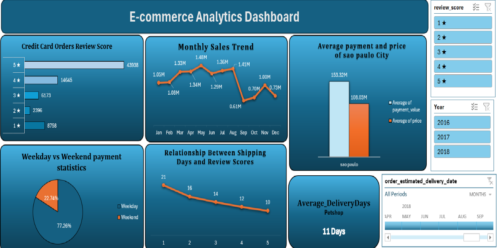
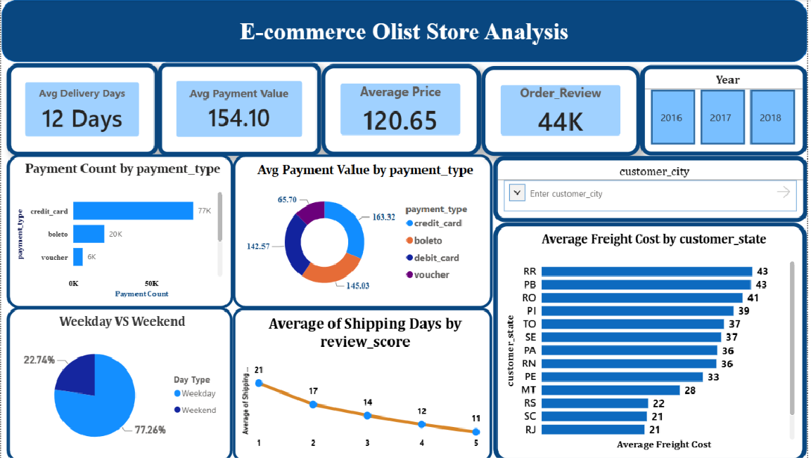
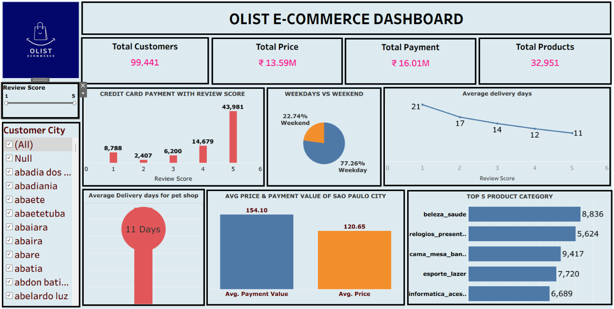

# E-Commerce Olist Store Analysis

## Project Overview

This project focuses on analyzing the Olist e-commerce dataset to understand payment patterns, customer satisfaction, delivery performance, product pricing, and seller sales.

The project uses Microsoft Excel, MySQL, Power BI, and Tableau to clean, analyze, and visualize e-commerce data through SQL queries, interactive dashboards, and business insights.

## Project Objectives

- Analyze weekday and weekend payment patterns.
- Examine customer review scores and payment methods.
- Evaluate average delivery time for the Pet Shop category.
- Analyze average payment value and product price for customers in São Paulo.
- Understand the relationship between shipping duration and customer satisfaction.
- Analyze seller state-wise sales performance.
- Create interactive dashboards to communicate findings and support data-driven decisions.

## Tools and Technologies

- **Microsoft Excel:** Data analysis, pivot tables, and interactive dashboards.
- **Power Query:** Data cleaning and transformation.
- **MySQL:** Database management and SQL-based analysis.
- **Microsoft Power BI:** Interactive dashboards and drill-through analysis.
- **Tableau:** Data visualization and trend exploration.
- **Microsoft PowerPoint:** Project presentation and communication of findings.

## Project Components

### 1. Excel Dashboard

The Excel dashboard presents e-commerce analysis through charts, pivot tables, and interactive slicers.

**Dashboard Preview**



### 2. SQL Analysis

MySQL was used to prepare the database and analyze payment patterns, customer reviews, delivery performance, product pricing, payment values, and seller sales.

**SQL Files**

- [Database and Table Setup](SQL/olist_ecommerce_01_Database_Table_Setup.sql)
- [SQL Analysis Queries](SQL/02_All_Reguiements.sql)

### 3. Power BI Dashboard

The Power BI dashboard presents interactive visualizations for payment behavior, delivery performance, and customer satisfaction. It supports exploration of the data through report interactions and drill-through functionality.

**Dashboard Preview**



### 4. Tableau Dashboard

The Tableau dashboard supports geographic analysis, trend exploration, and visual comparison of e-commerce performance.

**Dashboard Preview**



### 5. Project Presentation

The presentation summarizes the project requirements, analytical approach, dashboards, findings, and recommendations.

- [View Project Presentation](Presentation/E-Commerce-Olist%20Store-Analysis-Final%20PPT.pptx)

## Skills Demonstrated

- Data cleaning and transformation using Power Query
- SQL querying and data aggregation
- E-commerce data analysis
- Payment pattern analysis
- Customer review and satisfaction analysis
- Delivery performance analysis
- KPI analysis and dashboard development
- Data visualization using Excel, Power BI, and Tableau
- Communicating analytical findings and recommendations

## Repository Structure

```text
ecommerce-analytics/
├── Excel/
│   └── Excel dashboard files
├── SQL/
│   ├── olist_ecommerce_01_Database_Table_Setup.sql
│   └── 02_All_Reguiements.sql
├── Power-BI/
│   └── Power BI dashboard files
├── Tableau/
│   └── Tableau dashboard files
├── Presentation/
│   └── Project presentation
├── Screenshots/
│   ├── Excel-Dashboard.png
│   ├── Power-BI-Dashboard.png
│   └── Tableau-Dashboard.png
└── README.md
```

## Conclusion

This project demonstrates the use of Excel, Power Query, MySQL, Power BI, and Tableau to analyze e-commerce data. It showcases practical skills in data preparation, SQL analysis, payment behavior, delivery performance, customer satisfaction, dashboard development, and communicating business insights to support data-driven decision-making.
